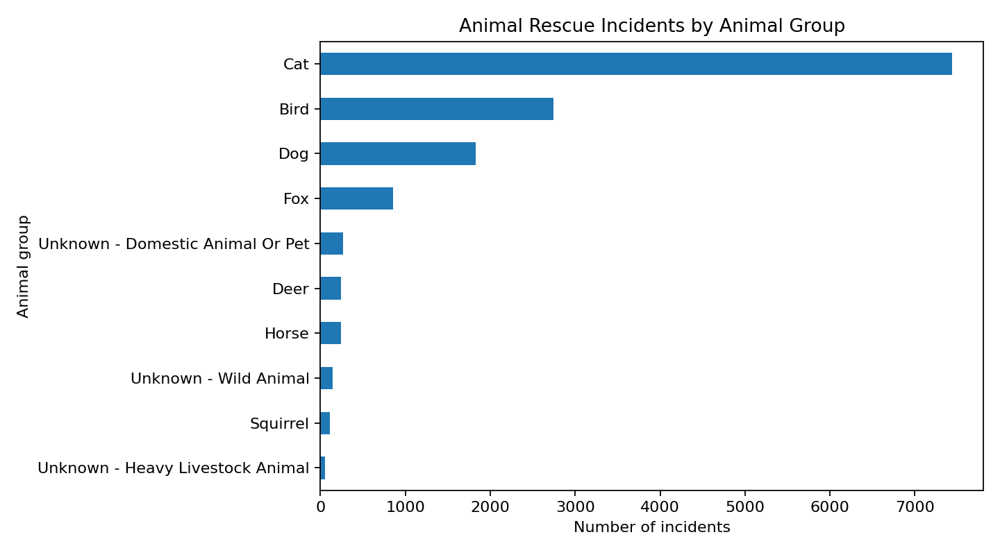
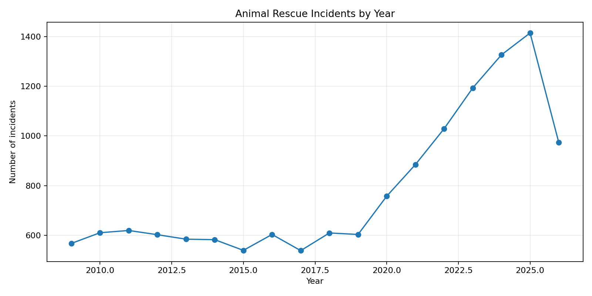
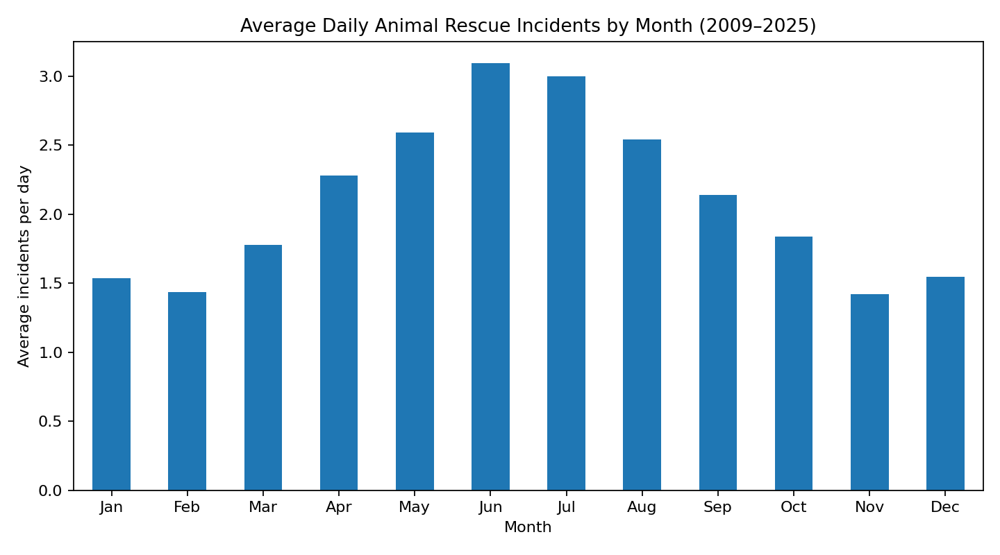
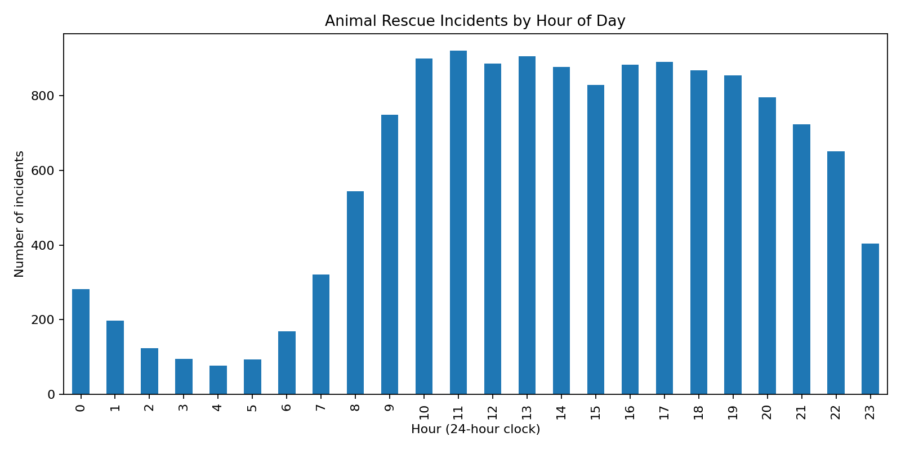
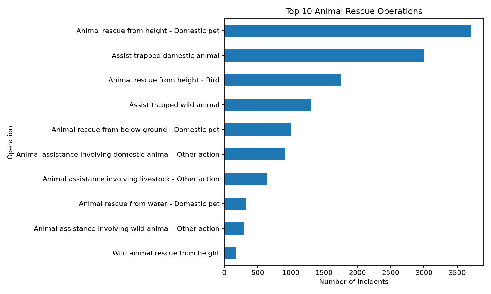
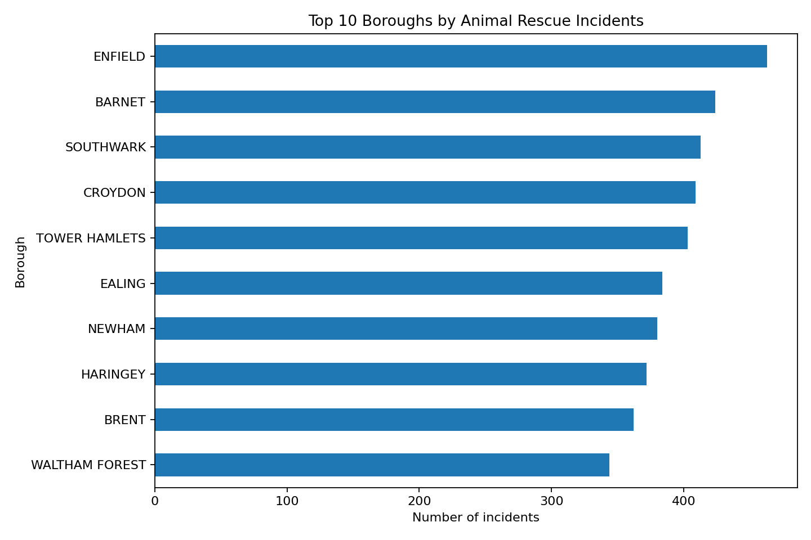

# London Fire Brigade – Animal Rescue Incident Analysis


## Project Overview
This project explores animal rescue incidents recorded by the London Fire Brigade from 2009 to July 2026. The analysis uses Python and Pandas to examine incident patterns by animal group, time, rescue operation and borough.

## Objectives
- Understand which animal groups account for the largest number of recorded incidents.
- Examine how incident counts change over time.
- Explore monthly and hourly patterns.
- Identify common rescue operations and boroughs with higher recorded counts.
- Explore relationships between recorded resource use and incident cost where data is available.

## Dataset
- File: `Data/Animal_Rescue_LFB_2009-2026_20cols.csv`
- Shape: 14,046 rows × 20 original columns.
- Coverage: January 2009 to July 2026.
- Dataset source: https://data.london.gov.uk/dataset/animal-rescue-incidents-attended-by-lfb-2ogkn

The dataset is included in this repository. Please check the dataset's original licence and attribution requirements before redistributing it.

## Tools and Libraries
- Python
- Jupyter Notebook
- Pandas
- NumPy
- Matplotlib
- Seaborn

## Repository Structure
```text
Animal_Rescue_EDA/
├── Data/
│   └── Animal_Rescue_LFB_2009-2026_20cols.csv
├── Visualizations/
│   ├── 01_animal_group_distribution.png
│   ├── 02_yearly_incident_trend.png
│   ├── 03_average_daily_incidents_by_month.png
│   ├── 04_incidents_by_hour.png
│   ├── 05_top_rescue_operations.png
│   └── 06_top_boroughs.png
├── notebooks/
│   └── Animal_Rescue_Analysis_Cleaned.ipynb
├── .gitignore
├── README.md
└── requirements.txt
```

## Key Findings
- Cats account for 7,435 incidents (52.93%) and are the largest animal group in the dataset.
- Cats, birds and dogs together account for approximately 85.45% of recorded incidents.
- 2025 has the highest annual incident count in the available data. 2026 covers January to July only and is not a complete year.
- 11:00 is the busiest recorded hour.
- June has the highest average daily incident count when comparing complete years from 2009 to 2025.
- Enfield has the highest recorded incident count among the boroughs in this dataset.
- Pump count and incident notional cost show a moderate positive correlation (approximately 0.49) among rows where both values are available. Correlation does not establish causation.

## Visualizations

### Animal Group Distribution


### Yearly Incident Trend


### Average Daily Incidents by Month


### Incidents by Hour


### Top Rescue Operations


### Top Boroughs


## Analysis Workflow
1. Load and inspect the dataset.
2. Check data types, missing values and duplicate records.
3. Clean selected text fields and standardise animal-group labels.
4. Parse the incident date/time and create time-based features.
5. Explore incident patterns using summary statistics, groupings and visualisations.
6. Interpret results while considering missing data and coverage limitations.

## Data Quality and Limitations
- Some resource-use and cost fields contain missing values; these were not automatically imputed.
- Borough and ward values are missing for a small number of records.
- Latitude and longitude are missing for a substantial proportion of records, limiting location-based analysis.
- The 2026 data is partial (January–July).
- Borough totals are raw incident counts and are not adjusted for population.
- Incident counts represent recorded incidents, not the number of individual animals.
- Observed patterns are descriptive and should not be interpreted as proof of causes.

## How to Run
1. Clone or download this repository.
2. Install the dependencies:
   `pip install -r requirements.txt`
3. Open `notebooks/Animal_Rescue_Analysis_Cleaned.ipynb` in Jupyter Notebook or VS Code.
4. Run the notebook cells from top to bottom.

## Author
Created as a data analysis portfolio project By
**Nithin Shaju**

GitHub: https://github.com/Nithinshaju-co/
